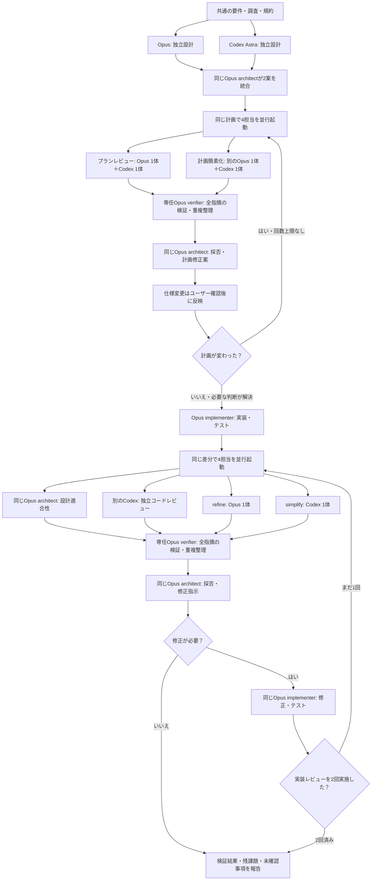

# shinaps-skills

Shinaps AIの利用者向け開発ワークフロー。Claude CodeとCodexそれぞれに適したplugin・カスタムエージェントとして配布する。スキルのダウンロードと導入にShinaps AIのアカウントは不要。サービスのrule検索・登録を使うときにアカウント作成と認証を行う。

## プロジェクトごとの条件

共通スキルが持つのは判断手順。対象環境・必須検証・公開条件は、対象プロジェクトの `AGENTS.md` / `CLAUDE.md` と参照先、README、CI、既存スクリプトから読み取る。専用設定ファイルは必須にしない。

例外として `linear` の開発進行とチーム設定の変更には、対象リポジトリの `.shinaps/linear.yaml` を必須にする。操作の継続的な許可と終了地点を会話から推測せず、合意した範囲だけを続けて進めるためである。設定はGit対象外の個人用ローカルファイルで、`.shinaps/.gitignore` の除外に含まれる。設定がなくてもIssueの読み取り・整理はできる。

例えばPCブラウザのみのプロジェクトには対応ブラウザと確認コマンドを書く。iOSプロジェクトにはSimulatorと実機の使い分けを記す。スキルは一律の端末数やOS数を追加しない。既存の情報で決まらず結果を左右する条件だけ確認し、保存を了承された方針をプロジェクト側に残す。

## スキル

| 名前 | 用途 |
|---|---|
| `explore` | 対話しながら既存挙動と変更影響を調べる |
| `spec` | 目的・仕様・実現方法を詰める |
| `dev` | 計画・実装・簡素化・検証・レビューを進める |
| `debug` | 不具合の原因を検証する |
| `review` | 差分や既存コードをレビューする |
| `refine` | Shinaps AIのruleと実ファイルを照合する |
| `extract-rules` | PRレビューからruleを抽出する |
| `simplify` | 目的から見直して不要な構造や手順を削る |
| `commit` | 進め方（通常・自律）を `.shinaps/linear.yaml` の `commit_mode` か開始時の確認で決め、検証できる単位でコミットする |
| `create-pr` | リポジトリの規約に合わせてPRを作成する |
| `release` | 公開条件を確定し、対象バージョンの利用可能性を確認する |
| `linear` | LinearのIssue整理から、Codexの進行・Bridge経由のClaudeの実装・QA・Cycle報告までを進める |
| `dev-mixed` (Claudeのみ) | 比較実行用。`dev` の工程をOpusとCodex Astraの混成の担当で実行する (P1) |
| `dev-claude` (Claudeのみ) | 比較実行用。`dev` の工程をOpusの担当だけで実行する (P2: 1体 / P3: 2体) |
| `dev-codex-astra` (Codexのみ) | 比較実行用。`dev` の工程を `gpt-6-astra` の担当だけで実行する (P4: 1体 / P5: 2体) |
| `dev-codex-sol` (Codexのみ) | 比較実行用。`dev` の工程を `gpt-6.1-sol` の担当だけで実行する (P6: 1体 / P7: 2体) |

Claude版の `dev` は実装後にレビュー・規約照合・簡素化の提案を並行して集め、全結果を専任verifierが検証し、同じ architect が採否を統合して実装担当へ修正を依頼する。実装後のレビューは最大2ラウンドで終了する。コミット・PR・リリースは依頼された場合だけ進む。`autonomous-commit-review` の役割は `commit` に統合した。個人用の別AI呼び出し・ブラウザ管理・ゴール管理・動画制作はこのpluginに含めない。

`linear` は初版では利用者本人の環境向けで、Codexが進行とAgent QA、ClaudeがAI Terminal Bridge経由の依頼で実装を担当する。Bridge本体は同梱せず、導入済みのMCPとWebStormプラグインを使う。`SKILL.md` は担当ごとに両版で書き分け、共通の手順と書式は `references/` に置く。`references/` はClaude版を編集元としてCodex版へ同じ内容を複製し、テストで一致を確認する。

### 比較用 dev 入口

`dev-mixed`・`dev-claude`・`dev-codex-astra`・`dev-codex-sol` は、同じ工程でモデル・同じ役割の担当数・実行環境の差を比べるための入口である。通常の開発には `dev` を使う。比較用入口は、入口と比較条件ファイルを明示した依頼でだけ使う。引数には担当数（`dev-mixed` を除く）と比較条件ファイルが必須で、無ければ担当を起動せずに終わる。Codex版は `agents/openai.yaml` の `allow_implicit_invocation: false` で自動選択の対象から外している。Claude版は、利用者が委託したCodexがAI Terminal Bridgeで依頼して起動できるよう、モデルからの呼び出し（Skillツール）を許可している。Claude Codeには、モデルからの呼び出しを許したまま自動選択の候補からだけ外す設定が無い（`disable-model-invocation: true` はSkillツールからの起動も拒否する）。このため、Claude版は説明文で、入口と比較条件ファイルを明示した依頼だけが対象だと示す。誤って選ばれても、引数が無ければ上の必須検査で担当を起動せずに終わる。

- 共通資料（工程・構成表・担当指示・起動手順・実行記録・比較手順）は plugin ルートの `references/dev-comparison/` に置く。Claude版を編集元としてCodex版の同じパスへディレクトリ全体を複製し、テストで一致と plugin 内での参照解決を確認する。
- 工程は eafbbc5 の Claude版 `dev` から作り、既存の `dev` とは独立に管理する。既存の `dev` を変更したとき比較工程へ反映するかは、その都度判断する。
- 1体／2体の設定が変えるのは、独立設計・計画レビュー・計画簡素化の担当2の有無だけである。実装は常に1体で、実装後の設計適合性・独立コードレビュー・refine・簡素化は1体の設定でも行う。
- 担当には比較専用の担当指示（`references/dev-comparison/roles/`）を使う。Claudeの担当は汎用のAgent（Opus / medium を明示）、P1のCodexの担当は `codex exec` で起動し、担当指示の全文を依頼に入れる。Codexの親（P4〜P7）は、担当指示から生成した比較専用の役割（`plugins/shinaps-codex/agents/shinaps-comparison-*.toml`）をサブエージェントの `agent_type` に指定して起動し、モデル・推論は起動時に選ぶ。通常の dev の登録エージェントは比較に使わず、変更もしない。サブエージェントが親から引き継ぐ設定と同時実行の上限は、[構成表](plugins/shinaps-claude/references/dev-comparison/configurations.md)の「環境の条件」に書く。
- P1 は現行の Claude版 `dev` の担当割当を再現するが、比較専用の担当指示を使い review / refine / simplify スキルを経由しないので、現行 `dev` の実行結果そのものではない。
- 検証の限界: リポジトリのテストが確認するのは、共通資料の一致と参照の解決、Claude版の入口をSkillツールから起動できる設定であること、比較専用の役割定義が担当指示から生成されていることまで。モデル・推論・tierは各実行の実行記録で指定値と観測値を分けて記録し、ローカル記録に実際の値が残らない項目（Codexのservice_tier、Claudeのpermission mode）は「指定のみ」として全構成で併記し、確認済みとは扱わない。7構成の工程の完走は保証しない。

手順は[比較手順](plugins/shinaps-claude/references/dev-comparison/comparison.md)と[構成表](plugins/shinaps-claude/references/dev-comparison/configurations.md)を参照する。

## Claude Code

```text
/plugin marketplace add sh1n4ps/shinaps-skills
/plugin install shinaps@shinaps-skills
```

ユーザースコープで利用する。呼び出しは `/shinaps:dev`、`/shinaps:create-pr` など。ローカル開発中はmarketplaceにこのcheckoutの絶対パスを登録し、変更後にpluginを更新する。pluginキャッシュへ直接編集しない。更新後は新しいセッションで確認する。

## Codex

Node.js 22以上と、`plugin marketplace add` / `plugin add` に対応したCodex CLIを使う。Claude Codeのインストールは不要。ただし `linear` の開発進行には、Claude CodeとAI Terminal Bridgeが必要になる。

導入・更新・削除:

```sh
npx @shinaps/skills@latest install codex
npx @shinaps/skills@latest update codex
npx @shinaps/skills@latest uninstall codex
npx @shinaps/skills@latest recover codex
```

`recover codex`は、中断した更新の記録が残っている場合に復元だけを行う。記録が無ければ何もしない。

ローカル開発では、このcheckoutから `node bin/skills.ts install codex` のように同じ操作を実行できる。Node.js 22.18以上なら型除去でTypeScriptをそのまま実行する (ビルド不要)。

CLIはスキルをCodex pluginとして登録し、13個のカスタムエージェントと、比較用入口だけが使う8個の比較専用の役割（`shinaps-comparison-*`）を`${CODEX_HOME:-~/.codex}/agents/`へ配置する。比較専用の役割も通常のセッションの役割一覧に表示されるが、説明文で比較用入口専用と示し、通常の `dev` は使わない。新しいセッションで`shinaps:dev`、`shinaps:review`等が読み込まれる。13個のカスタムエージェントのモデルと推論設定は親セッションから継承し、調査・レビュー担当は読み取り専用を既定にする。親セッションの実行時設定が優先される場合もあるため、権限の強制境界とは扱わない。

配布物は`~/.local/share/shinaps-ai/skills/codex/`へ保持し、一時的なnpxキャッシュに依存しない。同じ親ディレクトリの`state.json`に配置したエージェントと内容のハッシュを記録する。管理対象外の同名ファイルや、導入後に編集されたエージェントは上書き・削除せず停止する。必要な変更を退避・整理してから再実行する。`CODEX_HOME`を変更する場合は元の配置先で先にuninstallする。

uninstallはこのCLIのplugin・marketplace・管理済みエージェントを取り除く。個人用スキルと、別途登録したMCP接続・認証情報は保持する。

### 自動更新（Codex / macOS）

```sh
npx @shinaps/skills@latest auto-update enable codex
npx @shinaps/skills@latest auto-update status codex
npx @shinaps/skills@latest auto-update check codex
npx @shinaps/skills@latest auto-update disable codex
```

初期状態は無効。導入済みの利用者が`enable`するとmacOSのユーザーLaunchAgentを登録し、ログイン中に1日1回（12:00）確認する。スリープ中に12:00を過ぎた場合は起床時に1回だけ実行する。電源が切れていた回は実行しない。確認のたびにnpmから`latest`のパッケージを取得して実行し、導入版より新しい安定版の場合だけ更新する。古い版への自動ダウングレードはしない。更新内容は新しいCodexセッションから反映される。

`enable`は通常のログインシェルから実行する。CodexやClaude Codeのセッション内からは実行しない。登録時のPATH、npmの場所、`CODEX_HOME`が記録され、以後の確認でもそのまま使われる。ツールの場所を変えた場合は再度`enable`する。npmの設定は`~/.npmrc`のものが使われる。

登録直後に次の手順で動作を確認できる。`kickstart`はすぐに戻るので、npmの取得が終わるまで待ってから残りを実行する。

```sh
launchctl kickstart -k gui/$(id -u)/io.shinaps.skills.update
launchctl print gui/$(id -u)/io.shinaps.skills.update | grep 'last exit code'
npx @shinaps/skills@latest auto-update status codex
```

更新前に新版を準備し、旧スキル・エージェント・管理情報を退避する。更新中のエラー時は旧内容とCodexのプラグイン登録を復元する。強制終了などで復元できなかった場合は、次の更新確認時または`recover codex`の実行時に、`~/.local/share/shinaps-ai/skills/transaction/`に残った記録から復元する。復元にも失敗した場合は同じ場所にバックアップを保持して停止するので、エラーの原因を直してから`recover codex`を実行する。導入後のユーザー編集や同時更新は上書きせず停止する。

`status`は設定と最終確認結果を表示する。失敗の詳細は`~/.local/share/shinaps-ai/skills/auto-update-error.log`、通常ログは同じ場所の`auto-update.log`に記録する。npmがパッケージを取得できなかった場合は最終確認結果は更新されず、エラーログだけに記録される。通知ポップアップは出さない。`disable`は予定実行を停止し、導入したスキルは保持する。`uninstall codex`は予定実行も停止する。

macOS以外では予定実行の登録に対応していないため手動更新を使う。

Claude Codeは標準のmarketplace自動更新機能を使う。`/plugin` のMarketplacesから対象marketplaceのauto-updateを有効にする。GitHubから自動取得するにはリモートmarketplaceを登録する必要があり、ローカルcheckout登録ではソースのgit pullまで自動実行しない。

## 開発と配布

- Claude版: `plugins/shinaps-claude/`、marketplaceは`.claude-plugin/marketplace.json`
- Codex版: `plugins/shinaps-codex/`、marketplaceは`.agents/plugins/marketplace.json`
- Codexカスタムエージェント: `plugins/shinaps-codex/agents/`。`shinaps-comparison-*.toml` は `references/dev-comparison/roles/` から `npm run generate:agents` で生成し、直接編集しない
- 配布CLI: ソースは `bin/skills.ts` と `lib/*.ts`。`npm run build` (`tsc`) で `dist/` にJSを出力し、npmにはそれを配布する。Node.jsは`node_modules`配下の`.ts`に型除去を適用しないため、ソースのままは配布できない。checkoutでは型除去で直接実行するので、`enum`など型除去で消せない構文は使わない (`tsconfig.json` の `erasableSyntaxOnly`)

品質基準とプロジェクト設定の方針は揃えつつ、クライアント固有の実行手順・エージェント形式は別々に管理する。Claude向けのエージェント呼び出しをCodexに読み替えさせる方式は使わない。スキルを追加・変更した場合は両版への適用可否を判断する。

```sh
npm test
npm run check
npm pack --dry-run
```

公開前にはnpmスコープ`@shinaps`の利用権限とtarball内容を確認する。CLIのバージョンと両pluginのバージョンを揃える。開発中の同一バージョンも`update codex`で再配置できる。

### CIとnpm自動公開

`.github/workflows/publish.yml` はmainへのpush・PR・手動実行でテストと配布内容を検証する。通常のGitHub Releaseを公開すると、検証成功後に同じtagのパッケージをnpmへpublic公開する。prereleaseは公開しない。手動実行は検証専用で、npmへの公開は行わない。

リリース時は`package.json`と両plugin manifestのバージョンを揃えてコミットし、`v<version>` tagを対象にGitHub Releaseを公開する。tagとバージョンが不一致なら停止する。既存のnpmバージョンは再公開できないため、次の変更には新しいバージョンを使う。

npmの`@shinaps/skills`にGitHub ActionsのTrusted Publisherを登録する。GitHub ownerは`sh1n4ps`、repositoryは`shinaps-skills`、workflow filenameは`publish.yml`、direct publishを許可する。CIはGitHub-hosted Ubuntu・Node.js 24を使い、publish jobだけに`id-token: write`を付与する。`NPM_TOKEN` secretは不要。初回の信頼設定には本人認証が必要だが、その後のCI公開に毎回のセキュリティキー操作は不要。

ローカルで同じ配布検証を行うには`npm run verify:package`を使う。`RELEASE_TAG=v<version>`を付ければtag整合性も確認できる。npmのprovenanceは公開リポジトリからのTrusted Publishingが対象で、privateリポジトリでは生成されない。

### コード整形

`npm ci` で開発依存を導入し、`npm run format` でBiomeによる整形を行う。`npm run check` は整形と型 (`tsc --noEmit`) を検証する。`npm pack` と `npm publish` は `prepack` で自動的に `npm run build` を実行する。`npm run verify:package` は配布物の一覧を比較したうえで、tarballを一時ディレクトリにinstallして起動できることを確認する。Biomeは整形用途で使用し、lintとimportの自動整理は無効。Markdown・TOMLのエージェント定義は整形対象外。

## Shinaps AIとの接続

rule照合・抽出が必要な工程には `shinaps-ai` MCPを登録する。サービスURLは `https://app.shinaps.ai/mcp`。ClaudeとCodexそれぞれのMCP設定形式・ログイン手順に従う。開発用localhostはローカルサーバーを利用する場合だけ追加する。

MCP設定・認証はインストールと独立して行う。既存登録があれば再利用し、同じサーバーをpluginとグローバル設定の両方に登録しない。認証情報はCLIで独自に管理しない。

Claude Code:

```sh
claude mcp add --transport http shinaps-ai https://app.shinaps.ai/mcp --scope user
```

Claude Code内の`/mcp`から認証する。

Codex:

```sh
codex mcp add shinaps-ai --url https://app.shinaps.ai/mcp
codex mcp login shinaps-ai
```

未登録の利用者は[Shinaps AI](https://app.shinaps.ai)でアカウントを作成する。未認証でもスキルの導入は完了できる。MCPが使えないときに照合済みと報告しない。`simplify`・`commit`・`create-pr`・`release`・`linear` の基本手順はMCP接続を必須としない。

## Subagents (Claude: 16 / Codex: 13)

| Subagent | 役割 |
|---|---|
| `shinaps-explorer` | コードベース探索、必読ファイル抽出 |
| `shinaps-investigator` | `shinaps:explore` の現在の質問をコード・テスト・設定・履歴から調べ、確実性を分けて回答 |
| `shinaps-architect` | 設計。Claude版ではOpusが独立設計・Codex案との統合・設計適合性・プランと全指摘の最終判断を行う |
| `shinaps-plan-reviewer` | 計画レビュー (confidence 閾値 70)。Claude版はOpus 1体＋独立したCodex CLI 1体が指摘と修正案を返す |
| `shinaps-implementer` (Claudeのみ) | 確定した計画の実装・簡素化・検証、レビュー後の修正 (Opus) |
| `shinaps-reviewer` | logic / design / security / performance / maintainability / rule 統合レビュー (confidence 閾値 80) |
| `shinaps-review-validator` | reviewer 指摘の実コード検証 (confirmed / false positive / partial / out-of-scope 分類) |
| `shinaps-review-verifier` (Claudeのみ) | devの4担当の指摘を検証・重複整理し、出典・反証・対立をarchitectへ渡す (Opus) |
| `shinaps-simplifier` (Claudeのみ) | 計画簡素化のOpus担当。Codexと独立して仕様・構造の削減を提案 |
| `shinaps-refine-agent` | rule 照合 (Claude版はOpus 1体) (ファイル現状全文と照合、Violation / Improvement / Question 分類 + changed / pre-existing 切り分け) |
| `shinaps-spec-writer` | ヒアリング + 調査結果を spec.md 構造化 |
| `shinaps-tech-surveyor` | 外部技術調査 (WebSearch + WebFetch で 3-5 候補比較) |
| `shinaps-survey-validator` | tech-surveyor の出典を WebFetch で再確認 |
| `shinaps-debugger` | 症状から根本原因の仮説立案 (コードトレース + WebSearch + GitHub Issue) |
| `shinaps-debug-validator` | 仮説の実コード検証 (root-cause / contributing-factor / red-herring / needs-reproduction 分類) |
| `shinaps-split-reviewer` | `shinaps:commit` の通常モードの分割案を「単位の diff だけで妥当性を判断できるか」で批判 + 修正版最終分割計画 (worktree は read-only) |

Claude版はMarkdown、Codex版はTOMLで役割を定義する。

Claude版は全16エージェントが `opus / medium`。`dev` はOpus architectとCodex CLI (`gpt-6-astra` / medium / service tier default、fastなし) が同じ要件を独立に設計し、同じOpus architectが一つの計画にまとめる。プランレビューは別のOpus 1体＋Codex 1体、計画簡素化もそれぞれ別のOpus 1体＋Codex 1体。同じ計画を4担当が確認し、専任Opus verifierが全指摘を検証・重複整理してarchitectへ渡す。architectが採否を決め、計画が変われば4担当による確認を繰り返す。計画段階に回数上限は設けず、新しい根拠のない再提案・反復は行わない。機能・UX・契約・受入条件の変更はユーザーへ確認する。

実装と修正はOpus implementer 1体。実装後は `review` (開発レビュー)・`refine`・`simplify` をSkillツールで呼ぶ。同じOpus architectの設計適合性、別のCodexの独立コードレビュー、Opus 1体のrefine、Codex 1体のsimplifyを同じ差分で並行実行する。全4担当の結果を新しいOpus verifierが検証し、同じarchitectが全指摘の採否と一つの修正指示を返す。メインは起動・待機・記録・受け渡し・ユーザー確認を担い、指摘を先に選別・重複整理しない。

実装後レビューは最大2ラウンド。2回目の後に修正した場合はテスト・残課題と最終差分の再レビュー未実施を報告し、重大な未解決事項を完了扱いにしない。UIレビューは別途Codex側で行う。役割ごとにセッションと成果物を分け、今回の他担当の結果を独立レビューへ渡さない。Claude版のこの構成にはログイン済みのCodex CLIが必要。利用不能時にFableへ切り替えず未完了の工程を報告する。個人用 `ggc` / `ccc` aliasは使わず、[CLI担当の手順](plugins/shinaps-claude/skills/dev/references/codex-worker.md) に従う。

Codex版の `dev` とカスタムエージェントは親モデルを継承する既存の構成を維持し、Claude専用の実装・簡素化・指摘検証担当は追加しない。比較用入口だけが使う比較専用の役割（Codex版の `shinaps-comparison-*` 8個）は、この節のSubagent数に含めない。

**subagent 内では shinaps MCP を直接呼び出さず、rule 全文は Skill 側から prompt 経由で渡す** 原則を全 system prompt に明記する。MCP呼び出しの利用量が重複しないようにするため。


## Claude版 dev の流れ

OpusとCodexのeffortはmedium。CodexはAstra・標準速度。同じOpus architectが設計から最終判断まで担当する。



## 作業成果物

作業記録はプロジェクトルートの `.shinaps/work/` に保存する。初回作成時に `.shinaps/.gitignore` を内容 `*` と改行で作成する。既存のignoreは保持し、必要な場合だけ `*` を追記する。これによりignore自身を含む配下の未追跡ファイルが除外され、ユーザーによるグローバルignoreやプロジェクトルートのignore設定は不要になる。追跡済みファイルには効かないため、無断で追跡解除せず報告する。

```text
.shinaps/
├── .gitignore             # *
├── linear.yaml            # linear のプロジェクト設定（任意）
├── linear/                # linear の補足（任意）
└── work/
    ├── {日時}-{作業名}/
    ├── explorations/
    ├── specs/
    ├── reviews/
    └── debug/
```

旧 `.claude/shinaps/` の成果物はパスを指定して引き継げる。既存記録を自動移動・削除しない。共有する仕様書などの明示された納品先は尊重し、作業記録に秘密情報を含めない。

## 対応範囲

各クライアント向けの実行手順を提供する。形式検証や配置確認と、各CLIで実際にワークフローを完走したことは区別する。CLI・MCP・ブラウザ・デバイスの有無に依存する工程は実行時に確認する。環境別の網羅的な動作保証は行わず、実際の利用で見つかった問題を改善する。

## License

MIT
